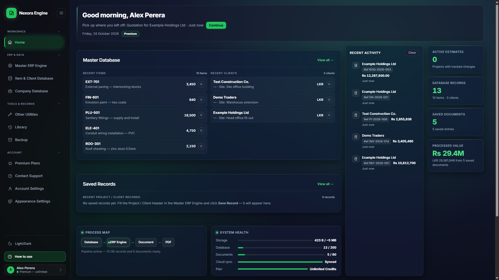
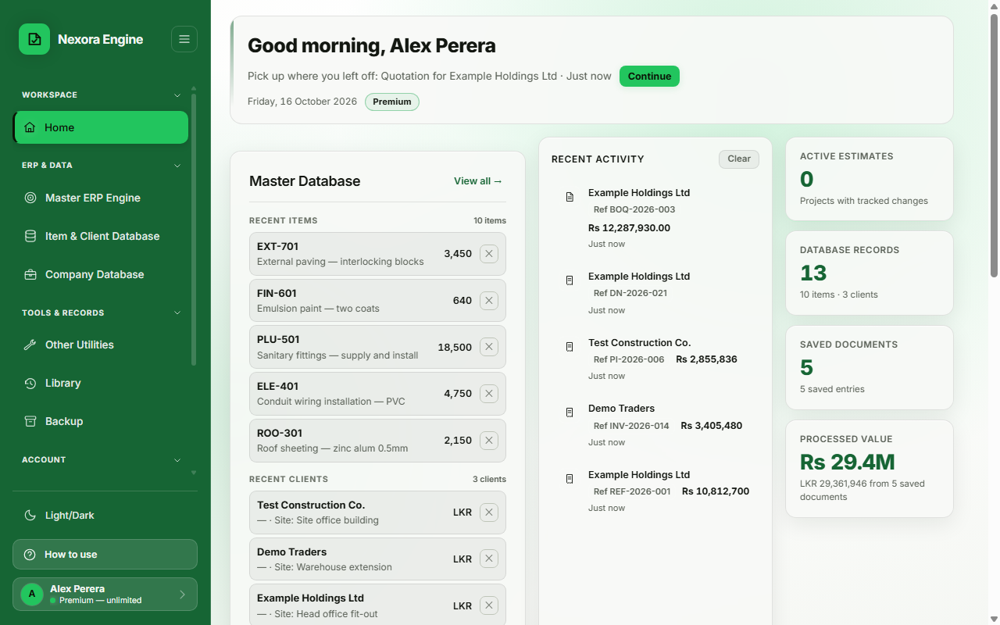
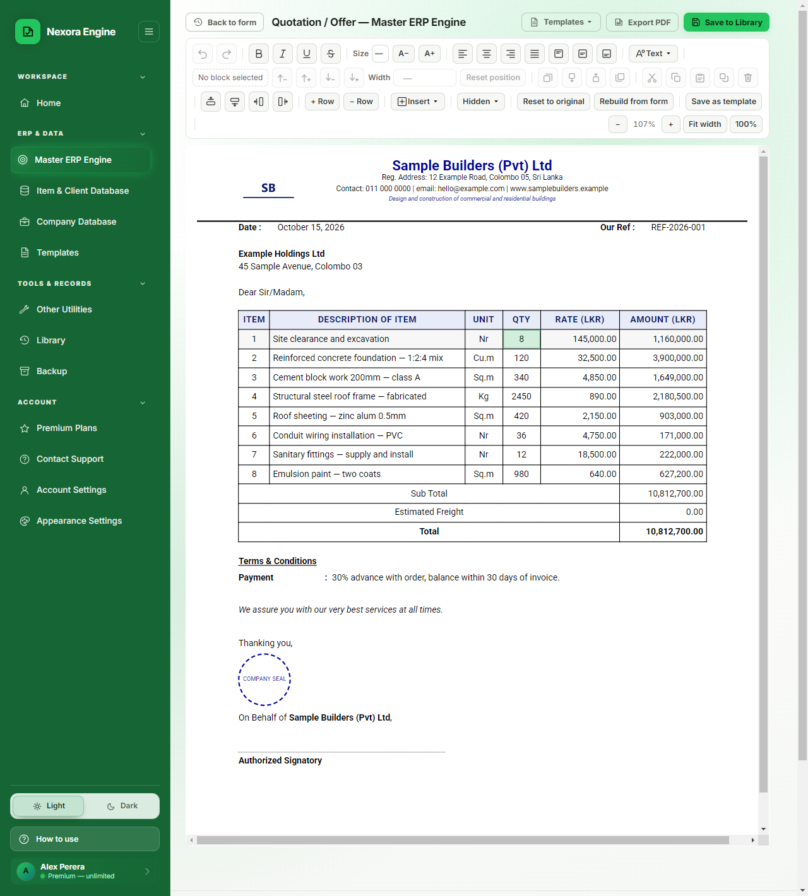
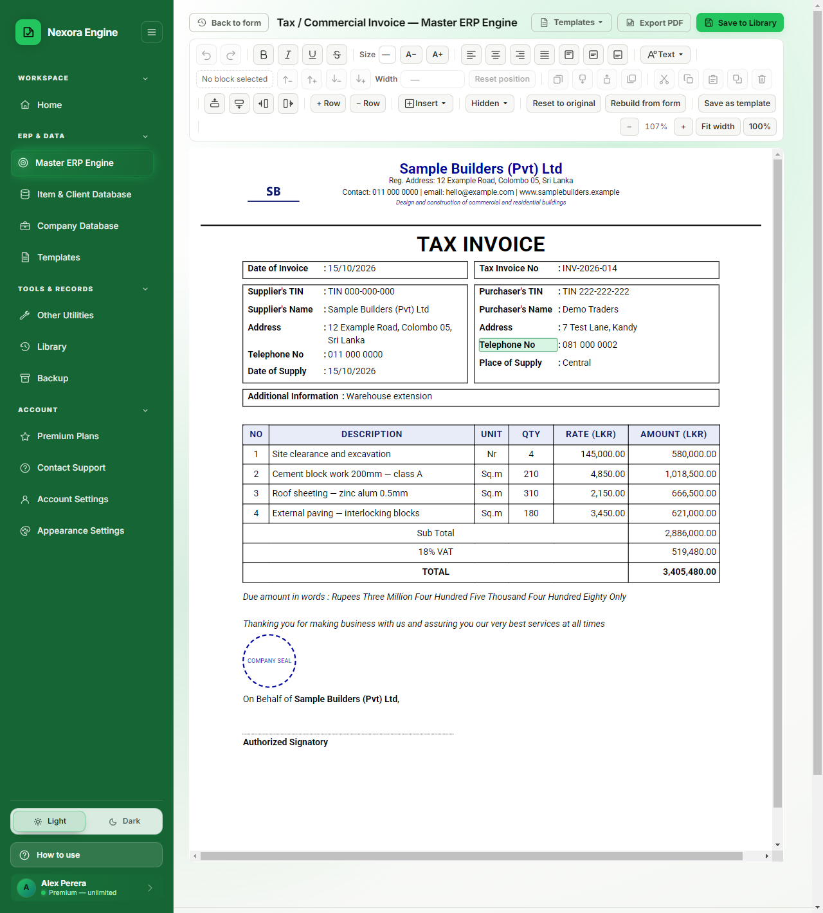
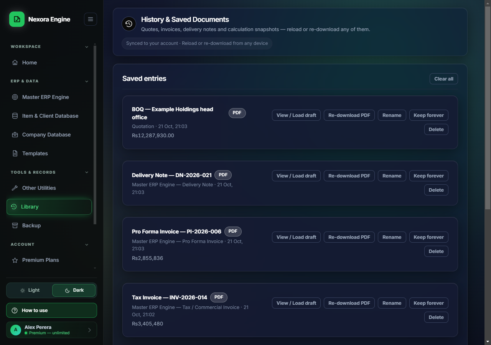
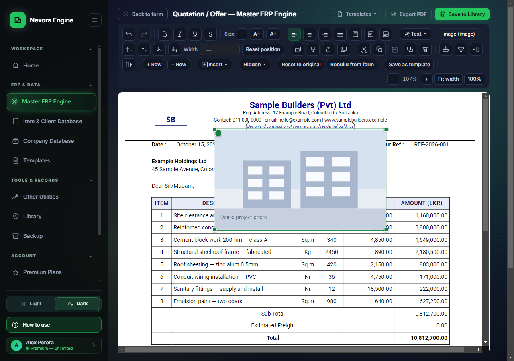
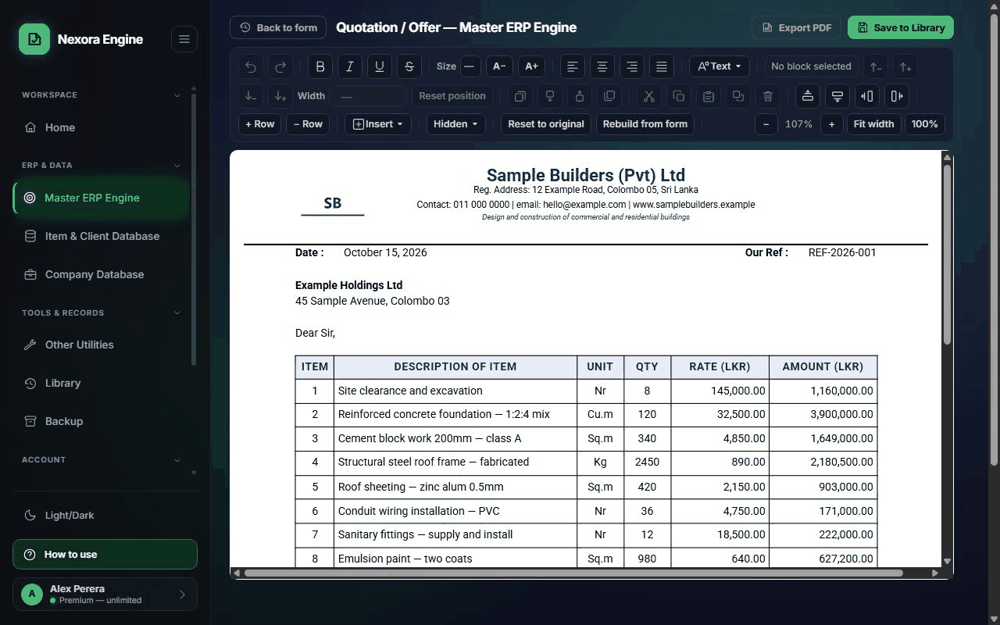

# Nexora Engine

> Business documents, estimating tools and calculators for contractors — one Windows app that works online or offline.

**[Download for Windows](https://nexora-download-page.vercel.app)**

**v0.1.9** · Windows 10 / 11 (64-bit) · 78.5 MB installer (82,340,925 bytes) · every build is also on [GitHub Releases](https://github.com/RealRren/nexora-engine-releases/releases)

`SHA-256 1b09e247c13997ce84e5a15655487559a3380e5e38819555825d96204d9af87f`

> This is a **showcase** repository. The source code is private. This page shows what the app does and how it was built.

---

## What it does

**Business documents (ERP)**
- Quotation, Pro Forma Invoice, Tax / Commercial Invoice, Delivery Note
- Totals, discount, VAT and freight calculated automatically
- Print to PDF exactly as shown on screen
- Export to Excel (.xlsx), verified in real Microsoft Excel

**Canva-style document editor**
- Move, resize, layer and overlap any element
- Insert text boxes, tables, images, shapes and extra pages
- Text tools: fonts, colours, lists, spacing, borders
- Copy / paste, multi-select, right-click menu, undo / redo
- Figures always stay tied to the form, so edits can't break the totals

**Letterhead and company seal**
- Your company details on every sheet and every printed page
- Upload a seal image once — it prints with the signature block

**Templates (Premium)**
- Save a finished layout as a template and start the next document from it
- Templates sync with the account, so a layout made on one PC is on the next

**Estimating tools and calculators**
- BOQ, Qty & Rate, Variation Order, Import Tax, Scope Guard report
- Calculator reports ready to print

**Library and cloud**
- Every document is saved, reloadable and re-downloadable from any device
- Synced to your account, and still usable offline
- A free account gets one free run of every tool; Premium lifts the limits on all of them at once ($12.99 / month or $124.99 / year, requested in the app)

**Account**
- Sign up with an emailed code, password reset by code
- Free and Premium plans
- Support tickets inside the app

**App**
- Windows desktop app, works offline, syncs when online
- Checks for a new release on every start and installs it
- Dark and light themes
- Sinhala and Tamil text supported
- Spell check in every text field

---

## Screenshots

| | |
|---|---|
|  |  |
| Home dashboard, dark | Home dashboard, light |
|  |  |
| Quotation, ready to print | Tax Invoice, ready to print |
|  |  |
| Saved documents library | Document editor |

### Editor in action

*All screenshots use demo data.*

---

## Built with

| Area | Technology |
|---|---|
| Front end | HTML, CSS, JavaScript |
| Desktop | Electron shell, Windows installer, automatic updates |
| Auth and database | Supabase (Postgres, Row Level Security) |
| Exports | Print-to-PDF, Excel (.xlsx) |
| Releases | GitHub Releases + electron-updater |

## How it was built

- Built with AI-assisted development: I planned each task, wrote the specs and acceptance checks, and reviewed every result before it was accepted.
- Every change runs through automated test sweeps (calculations, contrast/accessibility, login protection, Excel output, editor behaviour) before it is committed.
- Database access is locked down with Row Level Security: each user can only read and write their own rows.

---

## Status

Current release: **v0.1.9** (22 October 2026) · [All versions](https://github.com/RealRren/nexora-engine-releases/releases)

## Contact

Made by **[RealRren](https://github.com/RealRren)**. For questions, open an issue in this repository.
